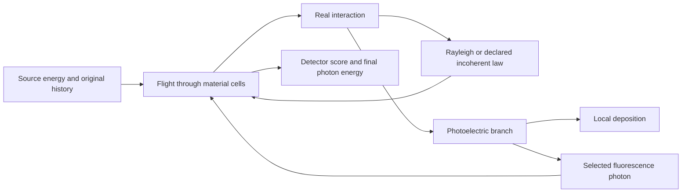

# Physical interactions and energy accounting

`PhysicalTransport` extends the material-cell walker with a supplied coherent scattering partial, atomic angular tables, discrete source energies, fluorescence and a fixed Woodcock majorant. The absorption and aggregate scattering arrays still define the macroscopic interaction rates in mm⁻¹, while this record supplies the conditional physical laws.

## Bind the interactions

For material `m`, voxel `v` and photon energy `E`, the extinction rate is

```text
mu[v,E] = density[m] * voxel_density[v]
          * (absorption[m,E] + scattering[m,E])
```

The coherent partial `rayleigh_mm_inverse[m,E]` lies within aggregate scattering. Real events select absorption, Rayleigh or the remaining declared `scattering_law` in proportion to their rates. Rayleigh preserves photon energy and uses the normalised unpolarised angular density `(1 + cos(theta)**2) * F(q)**2`, where `q = E*sin(theta/2)/hc` and `hc = 12.398419843320026 keV Å`. `AtomicScatteringTable` stores dimensionless `F` and `S` against increasing momentum transfer in Å⁻¹ with linear interpolation. Its support covers all incident source energies.

The remaining scattering channel follows the chosen isotropic elastic, free-electron Compton or [bound-electron Compton](bound-compton.md) law. Bound Compton uses occupied-shell momentum profiles and binding energies to sample Doppler-broadened photon energies. Conditional tables, energies and angular laws remain fixed during density differentiation. Supply one atomic table per material and coherent coefficients in material-major, energy-fastest order `(materials * energies,)`.

`xraylib_atomic_scattering` queries the installed xraylib 4.3.0 provider and retains its implementation hashes and BSD licence alongside the queried payload. A caller-supplied table instead retains the caller's `Provenance` record. Macroscopic coefficients require their declared density conversion: `(cm²/g) * (g/cm³) / 10` gives mm⁻¹.

## Trace a complete energy ledger

This complete CPU calculation uses explicitly synthetic atomic values and a one-material absorption slab. The atomic record supplies no coherent scattering in this calculation. A two-energy source samples one initial energy per original history, and the analogue energy ledger verifies conservation for absorption and escape.

```python
import hashlib

import numpy as np
import warp as wp

from dpt.materials import Provenance
from dpt.transport import (
    AtomicScatteringTable, HistoryBatch, MaterialGrid, PhysicalTransport,
    PlanarDetector, SourceSpectrum, TransportSpec, trace_energy_balance,
)
from dpt.transport.forward import prepare_transport

device, count = "cpu", 16
provenance = Provenance(
    source="Synthetic atomic table defined in this calculation",
    sha256=hashlib.sha256(b"q=(0,10);F=(1,0);S=(0,1)").hexdigest(),
    rights="Apache-2.0", description="Synthetic angular table",
)
atomic = AtomicScatteringTable(1, (0.0, 10.0), (1.0, 0.0), (0.0, 1.0), provenance)
physical = PhysicalTransport(
    (atomic,), (0.0, 0.0),
    spectrum=SourceSpectrum((40.0, 80.0), (0.25, 0.75), "Synthetic two-line source"),
)
transport = prepare_transport(
    TransportSpec(
        MaterialGrid((-1.0, -1.0, 0.0), (2.0, 2.0, 1.0), (1, 1, 1), 1),
        PlanarDetector((-1.0, -1.0), (2.0, 2.0), (1, 1), 2.0),
        80.0, "Synthetic absorption slab",
        coefficient_energies_kev=(40.0, 80.0), estimator="analogue",
    ),
    material_ids=wp.array([0], dtype=wp.int32, device=device),
    absorption=wp.array([0.3, 0.2], dtype=wp.float64, device=device),
    scattering=wp.array([0.0, 0.0], dtype=wp.float64, device=device),
    physical=physical, max_histories=count, device=device,
)
initial = wp.empty(count, dtype=wp.float64, device=device)
deposited = wp.empty(count, dtype=wp.float64, device=device)
final = wp.empty(count, dtype=wp.float64, device=device)
local = wp.empty(1, dtype=wp.float64, device=device)
trace_energy_balance(
    wp.array([(0.0, 0.0, -1.0)] * count, dtype=wp.vec3d, device=device),
    wp.array([(0.0, 0.0, 1.0)] * count, dtype=wp.vec3d, device=device),
    wp.ones(count, dtype=wp.float64, device=device),
    wp.ones(1, dtype=wp.float64, device=device),
    batch=HistoryBatch(41, 0, count), workspace=transport,
    out_pixel=wp.empty(count, dtype=wp.int32, device=device),
    out_score=wp.empty(count, dtype=wp.float64, device=device),
    out_energy=final, out_events=wp.empty(count, dtype=wp.int32, device=device),
    out_status=wp.empty(count, dtype=wp.int32, device=device),
    out_initial_energy=initial, out_deposited_energy=deposited,
    out_spectrum_index=wp.empty(count, dtype=wp.int32, device=device),
    out_local_deposition=local,
)
np.testing.assert_allclose(initial.numpy(), final.numpy() + deposited.numpy(), rtol=0, atol=0)
assert np.isclose(float(local.numpy()[0]), deposited.numpy().sum())
```

Initial, final and deposited energies are unweighted FP64 keV values with shape `(histories,)`. The local deposition tally is FP64 `(voxels,)`, flattened from `(nz, ny, nx)` with x fastest, and includes source importance weight and amplitude. Divide that tally by the original-history count to obtain mean deposited energy. It is zeroed once per call. All output arrays are caller-owned and disjoint from inputs and one another.

`trace_energy_balance` requires analogue transport. A completed history satisfies `initial = final + deposited` even if its escaping photon misses the detector. Photoelectron, Compton recoil and residual vacancy energy deposit locally under the selected model. A positive cutoff deposits the residual photon energy in its current cell before a coefficient lookup below that cutoff.

## Declare fluorescence

`FluorescenceLine` supplies an emitted line energy, its parent threshold and a conditional probability at each coefficient-energy node. Above threshold, an absorption event selects at most one line. The line photon continues isotropically and the difference between incident and line energy deposits locally. The complementary branch deposits all energy locally. Line probabilities for one material sum to at most one at every node.

`xraylib_fluorescence_lines` queries explicitly named individual transitions such as `KL2_LINE` and `KL3_LINE`. It retains the provider's jump-factor model, fluorescence yields, radiative fractions and provenance. The supplied single-vacancy model accounts for its photoelectron and residual vacancy energy locally. The energy ledger therefore follows the declared line process without assuming electron or cascade transport.

Fluorescence requires analogue transport, and emitted energies above the cutoff must lie within coefficient support. Rayleigh and a sampled source spectrum can also be used with continuous absorption when fluorescence and Woodcock tracking are absent.

## Choose a fixed majorant

An optional energy-dependent majorant `M[E]` replaces cell-boundary free-flight sampling with Woodcock candidates of rate `M`. Each candidate is real with probability `mu/M`, while a null candidate preserves the photon. The supplied majorant stays fixed under density differentiation and must satisfy strict `M > mu` in every scaled cell and at every energy node. Preparation and dynamic-density validation check that slack.

Flights jump directly to the next candidate or the grid boundary. The walker checks the interpolated majorant at each new photon energy. If rounding consumes its margin, it uses cellwise traversal to preserve rate checks. Mixed-rate readout and next-event connection integrals also use cellwise traversal.

For a log-density score, a real mark contributes `+1` and a null mark contributes `-mu/(M-mu)`. The fixed-majorant candidate flight has zero density score. Null candidates consume the declared event budget, so exhausting it invalidates the whole estimate. The same energy-ledger and original-history denominator apply to either traversal.


